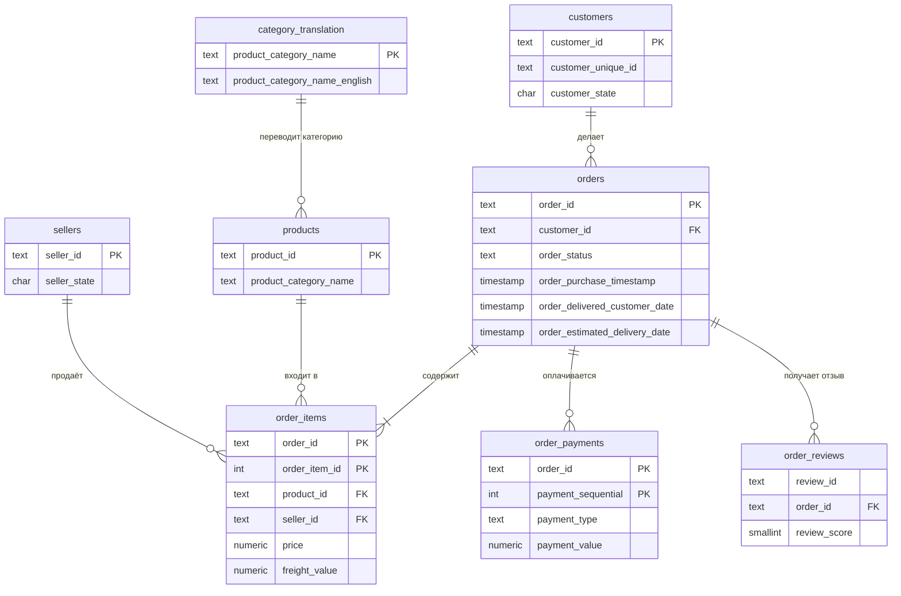

# Анализ e-commerce маркетплейса Olist на SQL

Исследование ~100 тысяч реальных заказов бразильского маркетплейса **Olist** (2016–2018) в PostgreSQL.
Цель - разобраться, как растут продажи, кто и как покупает, и найти, что мешает бизнесу расти дальше.

**Стек:** PostgreSQL · pgAdmin · SQL (JOIN, GROUP BY, HAVING, CASE WHEN, подзапросы, агрегатные функции)

---

## Бизнес-вопросы

1. Как менялись продажи по месяцам?
2. Какие категории и регионы приносят больше всего выручки?
3. Как покупатели платят?
4. Влияет ли скорость доставки на оценку покупателя?
5. Возвращаются ли покупатели за повторной покупкой и почему нет?

## Ключевые выводы

> Период: январь 2017 - август 2018, только доставленные заказы.
> Выручка - сумма цен товаров без доставки, валюта - бразильский реал (BRL).

**📈 Продажи**
- Месячная выручка выросла **в 7,5 раза**: со 112 тыс. (январь 2017) до 839 тыс. BRL (август 2018).
- Пик - **ноябрь 2017 (Black Friday)**: 7 289 заказов и 988 тыс. BRL. С начала 2018 года рост остановился на уровне 6–7 тыс. заказов в месяц.
- Больше заказов - не всегда больше денег: в мае 2018 заказов меньше, чем в ноябре 2017, а выручка почти та же за счёт более высокого среднего чека (≈145 против ≈136 BRL).

**🛒 Категории и регионы**
- Лидеры по выручке: «Красота и здоровье» (1,23 млн), «Часы и подарки» (1,17 млн), «Товары для дома» (1,02 млн).
- Категории зарабатывают по-разному: «Часы и подарки» - высокой ценой (≈199 BRL при средней по магазину ≈120), «Товары для дома» - количеством при низкой цене (≈93).
- **42% заказов** приходится на штат São Paulo, **две трети** - на три штата юго-востока (SP, RJ, MG).

**💳 Оплата**
- **74%** платежей - кредитной картой, **19%** - boleto (бразильская квитанция для оплаты наличными или через банк).
- У кредитной карты самый высокий средний платёж (163 BRL), вероятно, из-за возможности платить в рассрочку.

**🚚 Доставка и отзывы - главный вывод**
- **8%** заказов доставляются позже обещанного срока, и их средняя оценка падает **с 4,3 до 2,6**.
- В São Paulo заказ едет в среднем **8,7 дня**, на севере и северо-востоке (PA, MA, CE) - **21–24 дня**, а опаздывает там до 20% заказов.

**👥 Покупатели**
- **97%** покупателей сделали только один заказ, повторно покупают лишь 3%.
- Даже самые ценные клиенты не возвращаются: 9 из 10 крупнейших покупателей сделали всего одну покупку.

**Гипотеза:** одна из причин, по которой покупатели не возвращаются, - доставка: опоздания резко ухудшают впечатление, а за пределами юго-востока заказы едут в 2–3 раза дольше.
Проверить её можно, сравнив долю повторных покупок у клиентов, чей первый заказ опоздал, и у тех, кому привезли вовремя.

## Рекомендации бизнесу

1. **Улучшить доставку в отдалённые штаты** или обещать там реалистичные сроки: честные 25 дней лучше, чем опоздание при обещанных 15.
2. **Запустить программу удержания**: письмо или промокод после первой покупки. Сейчас рост идёт почти только за счёт новых клиентов.
3. **Готовиться к Black Friday заранее**: ноябрь даёт самый сильный всплеск заказов за год.
4. **Развивать продажи за пределами юго-востока**: остальная страна даёт лишь треть заказов.

---

## Проверка качества данных

Перед анализом данные проверены на пропуски, дубли и расхождения (`sql/03_data_quality.sql`):

- Данные охватывают сентябрь 2016 - октябрь 2018, но по краям периода заказов единицы → анализируются только полные месяцы.
- 97% заказов доставлены → выручка считается только по статусу `delivered`.
- 610 товаров без категории.
- 789 `review_id` повторяются → у таблицы отзывов нет первичного ключа по `review_id`.
- `customer_id` создаётся на каждый заказ, а реального человека определяет `customer_unique_id` (96 096 человек на 99 441 заказ).
- Сумма оплат расходится с ценой товаров и доставки только у 0,25% заказов → на анализ не влияет.

## Структура базы данных



## Структура проекта

```
olist-sql-analysis/
├── data/
│   └── README.md                  # откуда скачать CSV (сами файлы не хранятся в репозитории)
└── sql/
    ├── 01_schema.sql              # создание таблиц: первичные и внешние ключи, ограничения
    ├── 02_load.sql                # загрузка CSV, индексы, проверка количества строк
    ├── 03_data_quality.sql        # проверка качества данных
    ├── 04_sales_analysis.sql      # продажи: месяцы, категории, штаты, оплата, доставка и оценки
    └── 05_customers_delivery.sql  # повторные покупки, топ покупателей, доставка по штатам
```

## Какие навыки SQL показаны

| Навык | Где посмотреть |
|-------|----------------|
| Создание таблиц: типы данных, PRIMARY KEY, FOREIGN KEY, CHECK, индексы | `01_schema.sql`, `02_load.sql` |
| SELECT, WHERE, ORDER BY, LIMIT | все файлы |
| JOIN нескольких таблиц, LEFT JOIN для поиска пропусков | `03`–`05` |
| GROUP BY, HAVING, агрегатные функции COUNT, SUM, AVG | `03`–`05` |
| CASE WHEN, подзапросы, работа с датами | `04`, `05` |

## Как запустить

1. Установить PostgreSQL и pgAdmin.
2. Скачать датасет с [Kaggle](https://www.kaggle.com/datasets/olistbr/brazilian-ecommerce) и распаковать CSV в папку `data/`.
3. В pgAdmin создать базу `olist`.
4. Выполнить `sql/01_schema.sql` в Query Tool.
5. Выполнить `sql/02_load.sql`: команды `\copy` - в **PSQL Tool** (путь к файлам заменить на свой), остальное - в Query Tool.
6. Файлы `03`–`05` - аналитические запросы, их можно запускать по одному.

## Источник данных

[Brazilian E-Commerce Public Dataset by Olist](https://www.kaggle.com/datasets/olistbr/brazilian-ecommerce), Kaggle, лицензия CC BY-NC-SA 4.0.